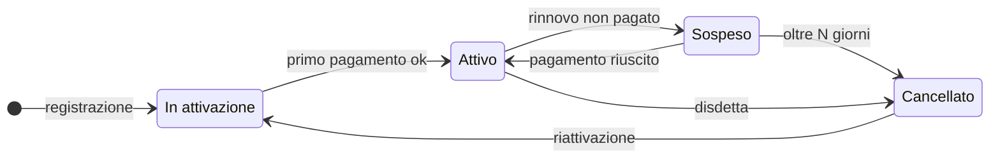
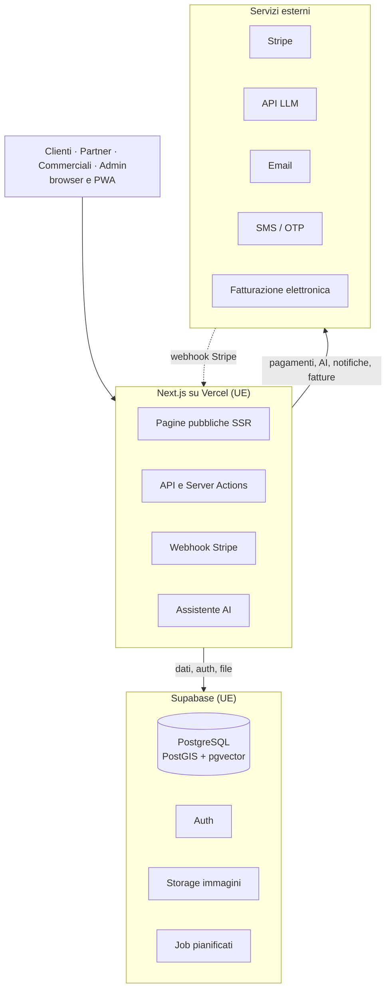

# PRD — Piattaforma Casa & Professionisti

*Nome commerciale e nome della mascotte da definire.*

| Campo | Valore |
|---|---|
| Versione | 0.1 (bozza) |
| Data | 20 ottobre 2026 |
| Stato | In revisione |
| Fonti | *Masterplan Operativo di Piattaforma*; *La Monetizzazione Blindata e le Proiezioni di Crescita* |
| Area di lancio | Veneto (Venezia, Padova, Treviso e province limitrofe) |

---

## 1. Sommario

La piattaforma è un aggregatore web che mette in contatto chi cerca casa o servizi per la casa con le aziende del territorio. Ha due anime:

- **Lato cliente (B2C):** due macro‑sezioni, *Trova Casa* (comparatore di agenzie immobiliari) e *Trova Professionista / Artigiano* (tecnici e artigiani filtrabili per zona e tipo di lavoro). Il cliente sceglie un profilo e invia una richiesta di contatto guidata e qualificata.
- **Lato partner (B2B):** agenzie, geometri/studi tecnici, artigiani e partner B2B (mutui, utility, notai) pagano un **abbonamento fisso** mensile o annuale e possono acquistare **token prepagati** per ottenere visibilità extra e lead aggiuntivi. Ogni partner gestisce in autonomia la propria scheda.

Un **assistente AI** impersonato dalla mascotte (un geco, con un outfit diverso per ogni sezione) guida i clienti nella navigazione e consiglia i partner su come usare al meglio scheda e token. L'identità visiva usa toni verde bosco e verde salvia.

Il modello di business è **ibrido e prepagato**: niente pagamento a consumo puro, incasso sempre anticipato via Stripe, sospensione automatica dell'account in caso di mancato pagamento.

---

## 2. Problema, obiettivi e non‑obiettivi

### 2.1 Problema

- **Per i clienti:** il mercato immobiliare e delle ristrutturazioni è caotico. È difficile confrontare agenzie e professionisti della propria zona, capire i prezzi indicativi e sapere a chi affidarsi.
- **Per le aziende:** i portali generalisti sono costosi, aggressivi e spesso basati su lead a consumo che generano contestazioni continue e flussi di cassa imprevedibili.

### 2.2 Obiettivi di prodotto

1. Permettere a un cliente di trovare e contattare il partner giusto nella sua zona in pochi minuti, con un'esperienza pulita e guidata.
2. Consegnare ai partner lead **qualificati e verificati**, riducendo al minimo le contestazioni.
3. Rendere la piattaforma **auto‑alimentata**: i contenuti (schede, foto, listini) li inseriscono e mantengono i partner, non il team.
4. Garantire **incasso anticipato e prevedibile** tramite abbonamenti ricorrenti e crediti prepagati.
5. Supportare la **vendita sul campo** (porta a porta in studi e agenzie) con strumenti dedicati ai commerciali.

### 2.3 Obiettivi di business (dalle proiezioni)

| | Anno 1 — Veneto | Anno 2 — Triveneto | Anno 3 — Nord Italia |
|---|---|---|---|
| Geometri / studi tecnici | 80 | 250 | 600 |
| Agenzie immobiliari | 30 | 90 | 200 |
| Artigiani | 40 | 150 | 400 |
| Partner B2B (mutui, utility, notai) | 30 | 80 | 180 |
| **Totale partner** | **180** | **570** | **1.380** |
| Fatturato lordo stimato | 195.000 € | 850.000 € | 2.784.000 € |
| Costi operativi stimati | 5.000 € | 15.000 € | 35.000 € |
| Utile netto pre‑tasse stimato | 190.000 € | 835.000 € | 2.749.000 € |
| **Ricavo medio implicito per partner** | **≈ 1.083 €/anno (≈ 90 €/mese)** | **≈ 1.491 €/anno (≈ 124 €/mese)** | **≈ 2.017 €/anno (≈ 168 €/mese)** |

Il ricavo medio implicito (fatturato ÷ partner, inclusi token) è il riferimento per definire i prezzi dei piani (§7.1). Le proiezioni presuppongono che i partner siano attivi per tutto l'anno; con acquisizioni distribuite nei mesi il fatturato effettivo sarà inferiore. Le voci di costo ricorrenti introdotte dallo stack sono elencate in §19.

### 2.4 Non‑obiettivi (prima release)

- Pubblicazione di annunci immobiliari da privati.
- Pagamento online dei lavori tra cliente e partner (la piattaforma genera il contatto, non intermedia il pagamento).
- App native iOS/Android (si parte con un sito mobile‑first installabile come PWA).
- Preventivatore automatico vincolante (i prezzi pubblicati sono **indicativi**).

---

## 3. Utenti e ruoli

| Ruolo | Descrizione | Accesso |
|---|---|---|
| **Visitatore** | Chi naviga senza account | Ricerca, profili, recensioni, assistente AI, invio richiesta (con verifica) |
| **Cliente** | Visitatore che ha inviato almeno una richiesta o si è registrato | Storico richieste, recensioni, preferenze privacy |
| **Partner — Agenzia immobiliare** | Agenzia presente in *Trova Casa* | Area Partner |
| **Partner — Professionista tecnico** | Geometra, architetto, ingegnere, certificatore APE, ecc. | Area Partner |
| **Partner — Artigiano** | Idraulico, elettricista, cartongessista, restauratore, ecc. | Area Partner |
| **Partner — B2B** | Consulenti mutui, fornitori utility, notai | Area Partner (scheda dedicata, §8) |
| **Membro del partner** | Collaboratore di un'azienda con accesso delegato | Area Partner con permessi limitati |
| **Commerciale** | Chi vende gli abbonamenti sul territorio | Area Commerciale (§9) |
| **Admin / Moderatore** | Team della piattaforma | Backoffice (§10) |

---

## 4. Glossario

| Termine | Significato |
|---|---|
| **Lead** | Richiesta di contatto inviata da un cliente a un partner, con contatti verificati |
| **Zona** | Area geografica basata su comuni e province ISTAT; un partner dichiara le zone che serve |
| **Categoria** | Tipologia di partner (es. *Idraulico*, *Geometra*, *Agenzia immobiliare*) |
| **Servizio** | Lavoro specifico all'interno di una categoria (es. *Pratiche catastali*, *APE*, *Posa cartongesso*) |
| **Piano** | Abbonamento (Base, Media, Professional) con visibilità e lead inclusi |
| **Quota lead** | Numero di lead inclusi nel piano per periodo di fatturazione |
| **Token** | Credito digitale prepagato, acquistabile a pacchetti, per visibilità extra e lead oltre quota |
| **Boost** | Sponsorizzazione temporanea di una scheda in una zona/categoria pagata in token |

---

## 5. Esperienza cliente (B2C)

### 5.1 Home e navigazione

- Ingresso immediato con due grandi accessi: **Trova Casa** e **Trova Professionista / Artigiano**.
- Barra di ricerca unica: *cosa ti serve* + *dove* (comune, con autocompletamento).
- Accesso sempre visibile all'**assistente AI** (il geco), che spiega come muoversi nel sito.
- Sezioni di fiducia: come funziona, recensioni verificate, partner in evidenza (etichettati come sponsorizzati quando pagati).

### 5.2 Trova Casa

Comparatore delle agenzie immobiliari presenti nella zona d'interesse.

**Requisiti**
- Ricerca per comune/provincia; elenco agenzie con punteggio in stelle, numero di recensioni, distanza, specializzazioni (vendita, affitto, commerciale, nuove costruzioni, lusso).
- Ordinamento per: rilevanza (default), valutazione, numero recensioni, distanza.
- Filtri: tipo di servizio (comprare, vendere/valutare, affittare), specializzazioni, solo agenzie con portfolio.
- Mappa con i risultati (vista lista/mappa).
- **Confronto affiancato** di 2–3 agenzie (valutazioni, servizi, zone, portfolio, tempi di risposta).
- Scheda agenzia con **portfolio immobili** (§6.4).

**Tipi di richiesta per le agenzie:** voglio comprare, voglio vendere / valutazione, voglio affittare / dare in affitto, informazioni su un immobile specifico del portfolio.

### 5.3 Trova Professionista / Artigiano

Sezione speculare a *Trova Casa*, con filtri più avanzati.

**Requisiti**
- Filtro per **zona** (es. Venezia, Padova, Treviso; comune o provincia).
- Filtro per **tipologia di professionista** o per **lavoro specifico** (es. idraulica, cartongesso, pratiche catastali di un geometra, restauro).
- La tassonomia è a due livelli (Categoria → Servizio) ed è gestita dall'admin (§10).
- Risultati con: stelle e recensioni, prezzo indicativo del servizio cercato (se pubblicato), zone servite, tempo medio di risposta, badge del piano.
- Ordinamento: rilevanza, valutazione, prezzo indicativo, distanza.
- Confronto affiancato di 2–3 profili, mappa, lista.

### 5.4 Profilo pubblico del partner

- Logo, nome, descrizione, categoria e servizi, zone servite, contatti di base (i dati di contatto diretti possono essere nascosti a scelta del partner per incanalare le richieste via form).
- **Listino prezzi indicativi** per i servizi standard (es. costo APE, €/mq per restauri), con nota chiara che sono indicativi.
- **Portfolio**: foto dei lavori svolti o immobili dell'agenzia.
- Recensioni con media, distribuzione delle stelle, sotto‑punteggi e risposte del partner.
- Pulsante principale **"Richiedi contatto"**.
- Pagina indicizzabile (SEO) con URL leggibile, es. `/professionisti/padova/idraulico/rossi-impianti`.

### 5.5 Richiesta di contatto (lead)

Modulo guidato in cui il cliente spiega le proprie esigenze e lascia i dati per essere ricontattato rapidamente.

**Flusso**
1. **Tipo di lavoro/richiesta**: precompilato dalla categoria del profilo, modificabile.
2. **Dettagli**: domande dinamiche per categoria/servizio, configurate dall'admin (es. metri quadri, tipo di immobile, piano, urgenza, budget indicativo, descrizione libera, foto opzionali).
3. **Luogo e tempi**: comune dell'intervento, quando vorrebbe iniziare, fascia oraria preferita per essere richiamato.
4. **Contatti**: nome, email, telefono; consenso privacy obbligatorio, consenso marketing separato e facoltativo.
5. **Verifica**: codice OTP via SMS (o link via email come alternativa). Solo le richieste verificate diventano lead.
6. **Conferma**: pagina di riepilogo; email al cliente con i dettagli e cosa aspettarsi.

**Dopo l'invio**
- Il partner riceve notifica (email + Area Partner) entro pochi secondi.
- Dopo alcuni giorni il cliente riceve un messaggio *"Sei stato ricontattato?"*: la risposta alimenta il tempo/tasso di risposta del partner e apre l'invito a lasciare una recensione.
- Se il partner non può gestire il lead (quota esaurita senza token, account sospeso), la piattaforma propone al cliente partner alternativi nella stessa zona e categoria. Il cliente non deve mai restare senza risposta.

**Requisiti antispam**: CAPTCHA invisibile, limite di richieste per numero/email/IP, rilevazione duplicati (stesso cliente, stesso partner, stesso servizio entro 30 giorni).

### 5.6 Recensioni

- Valutazione 1–5 stelle + sotto‑punteggi (qualità, puntualità, rapporto qualità/prezzo, comunicazione) + testo.
- **Recensione verificata**: può recensire solo chi ha inviato un lead verificato a quel partner. È indicato in modo chiaro come le recensioni vengono verificate.
- Il partner può rispondere pubblicamente e segnalare una recensione, ma non può cancellarla.
- Moderazione: filtro automatico (linguaggio offensivo, dati personali) + coda di revisione admin per le segnalazioni.
- Per l'ordinamento si usa una **media ponderata** (bayesiana), così pochi voti alti non scavalcano profili con molte recensioni solide.

### 5.7 Area cliente

Accesso tramite link magico via email o OTP, senza password obbligatoria.
- Storico richieste e stato (inviata, vista dal partner, ricontattato).
- Recensioni scritte.
- Gestione consensi, download ed eliminazione dei propri dati.

### 5.8 Assistente AI lato cliente (il geco)

- Spiega come usare il sito e orienta tra *Trova Casa* e *Trova Professionista*.
- Trasforma una richiesta in linguaggio naturale in una ricerca (es. *"devo rifare il bagno a Mestre"* → categoria idraulico/ristrutturazioni, comune Venezia‑Mestre) e propone i risultati.
- Aiuta a compilare la richiesta di contatto (suggerisce i dettagli utili per il professionista).
- Risponde a domande frequenti (cos'è un APE, che cosa fa un geometra, ecc.) con contenuti approvati.
- **Limiti**: dichiara di essere un'IA; non dà pareri legali, fiscali o tecnici vincolanti; non promette prezzi; non inventa partner o recensioni (usa solo dati restituiti dagli strumenti della piattaforma).

---

## 6. Area Partner (B2B)

### 6.1 Registrazione e onboarding

- Registrazione self‑service oppure su invito di un commerciale (§9), con piano e condizioni precompilati.
- Dati aziendali: ragione sociale, P.IVA, codice fiscale, indirizzo, **codice destinatario SDI o PEC** (per la fatturazione elettronica), referente, telefono.
- Scelta categoria/servizi e zone servite.
- Scelta piano (mensile o annuale) e pagamento anticipato tramite Stripe Checkout. L'account diventa **attivo** solo a pagamento confermato.
- Verifica: controllo formale della P.IVA; per i professionisti iscritti a un albo, numero di iscrizione (verifica manuale o semiautomatica). Badge *"Verificato"* sul profilo.
- **Wizard di completamento profilo** con indicatore di completezza (%) e consigli del geco.

### 6.2 Gestione scheda

Il partner modifica in autonomia: descrizione, logo, foto copertina, servizi, zone, orari, contatti, specializzazioni, certificazioni. Anteprima della scheda pubblica prima di salvare. Più utenti per azienda con ruoli (titolare, collaboratore).

### 6.3 Listino prezzi indicativi

- Per ogni servizio: prezzo da/a, unità (a corpo, €/mq, €/ora, €/intervento), note (cosa include/esclude).
- Esempi: APE a corpo; restauro €/mq; sopralluogo a corpo.
- Mostrato sul profilo e nei risultati quando il cliente cerca quel servizio.

### 6.4 Portfolio

- **Lavori svolti** (tecnici e artigiani): titolo, descrizione, comune, foto prima/dopo.
- **Immobili** (agenzie): tipologia, contratto (vendita/affitto), comune, prezzo, mq, locali, foto, stato (disponibile, trattativa, venduto).
- Limiti di foto/elementi in base al piano. Compressione e ridimensionamento automatici delle immagini.

### 6.5 Gestione lead

- Inbox dei lead con stato: *nuovo → visto → contattato → preventivo inviato → acquisito / perso*.
- Dettaglio lead: risposte del modulo, foto, contatti, fascia oraria preferita, azioni rapide (chiama, email, WhatsApp).
- Contatore **quota lead** del periodo (usati/inclusi) e saldo token.
- Segnalazione di lead non valido entro 72 ore (§7.4).
- Notifiche configurabili (email, push PWA; WhatsApp in fase successiva).
- Esportazione CSV.

### 6.6 Statistiche

Visualizzazioni della scheda, comparse nei risultati, clic su "Richiedi contatto", lead ricevuti, tasso e tempo di risposta, valutazione media nel tempo, rendimento dei boost (token spesi → visualizzazioni e lead extra). Nel piano Professional: confronto anonimo con la media della zona/categoria.

### 6.7 Abbonamento e fatturazione

- Piano attuale, data di rinnovo, metodo di pagamento, storico fatture.
- Upgrade/downgrade (upgrade immediato con calcolo proporzionale, downgrade al rinnovo).
- Passaggio mensile ↔ annuale.
- Gestione tramite **Stripe Customer Portal** (carta, addebito SEPA, fatture).
- Fatture elettroniche inviate allo SdI tramite provider dedicato (§12).

### 6.8 Wallet token

- Saldo, acquisto pacchetti, storico movimenti (acquisti, consumi, accrediti, scadenze).
- Attivazione **boost** scegliendo zona, categoria, durata; costo in token mostrato prima di confermare.
- Impostazione: *"usa automaticamente i token per i lead oltre quota"* sì/no.

### 6.9 Assistente AI lato partner

- Onboarding: spiega le funzioni dell'Area Partner e guida al completamento della scheda.
- Suggerisce miglioramenti alla scheda (foto mancanti, descrizione poco chiara, listino assente).
- **Consigli sui token**: in base a statistiche reali della scheda e della zona suggerisce quando e dove conviene un boost e stima il ritorno atteso, dichiarando che è una stima.
- Risponde a domande su piani, fatture e regole lead.
- Ha accesso **solo ai dati del partner autenticato**.

---

## 7. Monetizzazione

### 7.1 Piani in abbonamento

Contenuti indicativi: prezzi e soglie da definire (vedi §20). Riferimento: ricavo medio implicito di circa 90 €/mese per partner nell'anno 1, token inclusi.

| | Base | Media | Professional |
|---|---|---|---|
| Visibilità nei risultati | Standard | Priorità media | Priorità alta + badge |
| Lead inclusi per periodo | da definire | da definire | da definire |
| Zone servite | 1 provincia | fino a 2 province | fino a 4 province |
| Servizi nel listino | fino a 5 | fino a 15 | illimitati |
| Elementi portfolio | 10 | 30 | illimitati |
| Statistiche | Base | Complete | Complete + confronto zona |
| Utenti azienda | 1 | 2 | 5 |
| Token omaggio a ogni rinnovo | — | da definire | da definire |
| Posizione "In evidenza" in zona | — | — | Sì, a posti limitati (vedi §20, esclusiva di zona) |

- Fatturazione **mensile** o **annuale** (proposta: annuale con 2 mesi di sconto).
- Piani diversi per tipo di partner possibili (le agenzie potrebbero avere prezzi diversi dagli artigiani): la struttura dati lo prevede.

### 7.2 Regole di pagamento e sospensione

Pagamento **sempre anticipato** con addebito automatico (carta o addebito diretto SEPA) tramite Stripe Billing.

- **Sospensione immediata** al fallimento del pagamento: scheda nascosta dai risultati, richieste di contatto disattivate (il cliente viene indirizzato ad alternative), Area Partner accessibile solo per aggiornare il pagamento.
- A ogni rinnovo pagato l'account resta **Attivo** e la quota lead del periodo si azzera.
- Stripe continua i tentativi automatici; al pagamento riuscito l'account si **riattiva automaticamente**.
- Con l'addebito SEPA la conferma arriva dopo alcuni giorni lavorativi: per la **prima attivazione** si attende la conferma o si richiede la carta.
- Disdetta: effettiva a fine periodo pagato, nessun rimborso parziale (da confermare nei termini contrattuali).

### 7.3 Token (crediti extra)

Moneta digitale interna, **prepagata**, acquistabile solo da partner con abbonamento attivo.

| Uso | Descrizione |
|---|---|
| **Lead oltre quota** | Ricevere lead dopo aver esaurito la quota del piano |
| **Boost scheda** | Posizione sponsorizzata in cima ai risultati per zona e categoria, per un periodo |
| **In evidenza** | Lavoro o immobile mostrato nella home della zona |

- Pacchetti a taglio fisso (es. piccolo/medio/grande, con sconto crescente). Pagamento una tantum via Stripe Checkout, fattura elettronica emessa all'acquisto.
- Validità proposta: 12 mesi dall'acquisto. Consumo dei token più vecchi per primi.
- Registro movimenti **immutabile** (ledger): il saldo è sempre ricostruibile.
- Token non convertibili in denaro; i rimborsi dovuti per lead non validi vengono accreditati in token.
- Tutti i contenuti sponsorizzati sono **etichettati come tali**.

### 7.4 Regole sui lead (anti‑contestazione)

Il documento di monetizzazione individua nelle contestazioni sui singoli contatti il rischio principale. Regole proposte:

1. Un lead conta (quota o token) solo se è **verificato** (OTP) e **consegnato**.
2. Annullamento automatico, senza intervento umano, dei duplicati (stesso cliente, partner e servizio entro 30 giorni).
3. Il partner può segnalare un lead entro 72 ore solo per motivi oggettivi: numero inesistente o irraggiungibile, richiesta fuori dalle zone/servizi dichiarati, spam evidente. Non sono motivi validi "cliente non interessato" o "prezzo troppo alto".
4. Esito della segnalazione: automatico dove possibile (es. verifica numero), altrimenti admin entro 2 giorni lavorativi. Se accolta: restituzione di 1 lead di quota o dei token equivalenti.
5. **Lead oltre quota** (proposta di default): se l'opzione automatica è attiva, il lead consuma token; altrimenti il partner vede il lead con i contatti nascosti e ha 48 ore per sbloccarlo con token. Scaduto il tempo, il cliente riceve proposte alternative.

### 7.5 Ordinamento dei risultati e trasparenza

- **Risultati organici**, punteggio composto da: pertinenza (zona e servizio), valutazione ponderata, completezza della scheda, tasso e tempo di risposta, peso del piano.
- **Posti sponsorizzati** (boost) separati e sempre etichettati.
- I principali parametri di ordinamento sono spiegati in una pagina pubblica e nei termini per i partner.
- I pesi sono configurabili dall'admin senza rilascio di codice.

---

## 8. Partner B2B (mutui, utility, notai)

Le proiezioni includono partner B2B (30 nel primo anno), assenti nel masterplan. Proposta di funzionamento:

- Categoria dedicata *"Servizi per la casa"*: consulenza mutui, fornitori luce/gas/internet, notai, assicurazioni casa.
- Compaiono in modo **contestuale**: nel percorso *Trova Casa* (es. dopo la richiesta a un'agenzia: *"Ti serve un mutuo?"*) e nelle pagine guida.
- Stessa Area Partner e stessa logica di abbonamento + token; modulo di richiesta specifico (importo mutuo, tipo di fornitura, tipo di atto).
- Modello economico da confermare (§20).

---

## 9. Area Commerciale (vendita sul campo)

Il lancio avviene con vendita diretta porta a porta in Veneto, quindi serve uno strumento per i commerciali utilizzabile da smartphone.

- **Prospect**: elenco di studi, agenzie e artigiani da visitare (inserimento manuale o import CSV), con stato *da visitare → visitato → interessato → chiuso → perso*, note di visita, prossimo richiamo.
- **Mappa** dei prospect per pianificare il giro visite.
- **Attivazione in visita**: il commerciale crea la bozza di scheda insieme al cliente e invia un link di attivazione con piano ed eventuale coupon già impostati; il partner paga da solo via Stripe Checkout.
- **Attribuzione**: ogni partner acquisito resta collegato al commerciale (link o codice personale).
- **Report**: partner acquisiti, MRR generato, rinnovi e disdette per commerciale; export per il calcolo provvigioni.
- **Materiale**: demo della piattaforma, listino piani, condizioni contrattuali.

---

## 10. Backoffice Admin

- **Dashboard**: MRR, partner attivi per zona/categoria/piano, nuove attivazioni e disdette, lead inviati/verificati, token venduti e consumati, segnalazioni aperte.
- **Partner**: ricerca, verifica, sospensione/riattivazione manuale, impersonificazione in sola lettura per assistenza (tracciata).
- **Tassonomia**: categorie, servizi, unità di prezzo, domande dinamiche del modulo per servizio.
- **Zone**: attivazione progressiva di province e regioni (rollout Veneto → Triveneto → Nord Italia).
- **Piani e token**: prezzi, limiti, pacchetti, coupon, sincronizzati con Stripe.
- **Moderazione**: recensioni segnalate, segnalazioni lead, contenuti delle schede.
- **Contenuti**: FAQ, pagine guida e SEO, testi della mascotte, base di conoscenza dell'assistente AI.
- **Ranking**: pesi del punteggio organico e numero di posti sponsorizzati.
- **Commerciali**: utenti, zone assegnate, report.
- **Audit log** di tutte le azioni amministrative.

---

## 11. Brand identity e UI

### 11.1 Palette (proposta)

Toni eleganti e rilassanti che trasmettono professionalità e stabilità, lontani dai colori aggressivi dei portali generalisti.

| Token | Colore | Uso |
|---|---|---|
| `--verde-bosco-900` | `#1F3A2B` | Testate, footer, testo su sfondi chiari |
| `--verde-bosco-700` | `#2F5A41` | Pulsanti primari, link (testo bianco: contrasto 7,9:1) |
| `--salvia-500` | `#8FA98A` | Elementi decorativi, icone, bordi (non per testo bianco: contrasto 2,6:1) |
| `--salvia-200` | `#D5E0CF` | Sfondi di sezione, card selezionate |
| `--crema-50` | `#F6F5EF` | Sfondo pagina |
| `--testo` | `#1C2420` | Testo principale (contrasto 14,5:1 su crema) |
| `--stelle` | da definire | Stelle delle recensioni (unico accento caldo) |

Modalità scura opzionale in fase successiva. Tipografia: un sans‑serif leggibile per l'interfaccia, eventualmente un serif per i titoli per un tocco "di classe".

### 11.2 La mascotte: il geco

Accoglie i clienti, li guida nella ricerca e assiste i professionisti nell'area riservata. È anche l'avatar dell'assistente AI.

| Sezione | Outfit proposto |
|---|---|
| Home / benvenuto | Guida con zainetto e cartina |
| Trova Casa | Giacca da agente immobiliare, mazzo di chiavi |
| Trova Professionista | Casco giallo e cassetta degli attrezzi |
| Recensioni | Lente d'ingrandimento e stella |
| Area Partner | Consulente con tablet |
| Token e boost | Jetpack o razzo |
| Errori / pagina non trovata | Geco aggrappato a un muro crepato |

Le illustrazioni vanno prodotte in formato vettoriale (SVG) per icone, stati vuoti e messaggi. Tono di voce: amichevole ma professionale, dà del tu al cliente e del lei o del tu al partner (da decidere).

### 11.3 Principi di interfaccia

Mobile‑first, poche scelte per schermata, azioni principali sempre in evidenza, prezzi e sponsorizzazioni sempre chiari, nessun pop‑up aggressivo.

---

## 12. Stack tecnologico

Pensato per essere sviluppato e mantenuto da **un solo programmatore interno**: un unico linguaggio (TypeScript), servizi gestiti, poca infrastruttura da amministrare, dati in UE.

| Livello | Scelta | Perché |
|---|---|---|
| Frontend + backend | **Next.js** (App Router) + **TypeScript** | Un solo progetto per sito pubblico, Area Partner, Area Commerciale e Admin; rendering lato server per la SEO |
| UI | **Tailwind CSS** + componenti **shadcn/ui** | Design system con i token di brand, componenti accessibili |
| Database | **PostgreSQL** gestito (Supabase, regione UE) | Relazionale, affidabile; estensioni **PostGIS** (zone e distanze) e **pgvector** (ricerca semantica per l'AI) |
| ORM | **Drizzle** o **Prisma** | Schema tipizzato e migrazioni versionate |
| Autenticazione | **Supabase Auth** | Email + password, link magico, OTP; ruoli e Row Level Security |
| File e immagini | **Supabase Storage** + trasformazione immagini | Loghi, portfolio, foto dei lead |
| Pagamenti | **Stripe Billing** (abbonamenti), **Checkout**, **Customer Portal**, webhook | Pagamento anticipato, carta e SEPA, retry automatici |
| Fatturazione elettronica | Provider italiano con API (es. Fatture in Cloud, Aruba, Openapi) | Invio delle fatture B2B allo SdI, che Stripe non gestisce |
| Email transazionali | **Resend** o **Postmark** | Notifiche lead, conferme, fatture |
| SMS / OTP | **Twilio** o equivalente | Verifica dei lead |
| Ricerca | PostgreSQL full‑text + PostGIS; **Meilisearch** se i volumi lo richiedono | Semplice all'inizio, scalabile dopo |
| Mappe | **MapLibre** + tile OpenStreetMap (es. MapTiler) | Costi contenuti, nessun vincolo proprietario |
| Assistente AI | LLM via API (es. Claude di Anthropic) con **tool calling** + RAG su pgvector | Risposte basate solo sui dati e contenuti della piattaforma |
| Job in background | **pg_cron** + funzioni server; **Inngest** se servono flussi complessi | Promemoria, scadenze token, solleciti, report |
| Hosting | **Vercel** (regione Francoforte) | Deploy automatici, anteprime per ogni modifica |
| CAPTCHA | **Cloudflare Turnstile** | Antispam sui moduli senza fastidi per l'utente |
| Monitoraggio | **Sentry** (errori), **PostHog** EU (analytics prodotto), uptime monitor | Visibilità su errori e funnel |
| Qualità | **GitHub Actions**, **Vitest**, **Playwright** | Test automatici prima di ogni rilascio |

---

## 13. Architettura

### 13.1 Integrazione Stripe (eventi principali)

| Evento | Azione |
|---|---|
| `checkout.session.completed` | Collega cliente Stripe al partner; per i token, accredita il pacchetto |
| `invoice.paid` | Rinnovo: account **Attivo**, azzera la quota lead del periodo, accredita eventuali token omaggio, emette fattura elettronica |
| `invoice.payment_failed` | Account **Sospeso** immediatamente, notifica al partner |
| `customer.subscription.updated` | Cambio piano o periodicità, aggiorna limiti |
| `customer.subscription.deleted` | Account **Cancellato**, scheda rimossa dai risultati |

I webhook sono idempotenti (ogni evento elaborato una sola volta) e firmati.

### 13.2 Assistente AI

- **Strumenti** lato cliente: `cerca_partner(zona, categoria, servizio)`, `dettaglio_partner(id)`, `faq(domanda)`, `prepara_richiesta(...)`.
- **Strumenti** lato partner: `statistiche_scheda()`, `stato_quota_e_token()`, `stima_boost(zona, categoria, durata)`, `suggerimenti_scheda()`.
- Base di conoscenza (FAQ, guide, regole) indicizzata con pgvector e gestita dall'admin.
- Limiti di utilizzo per sessione e budget mensile di spesa API; risposte frequenti in cache.
- Nessun dato personale inviato al modello se non strettamente necessario.

---

## 14. Modello dati (entità principali)

| Entità | Campi principali |
|---|---|
| `users` | id, email, telefono, ruolo, creato_il |
| `partners` | id, tipo (agenzia, tecnico, artigiano, b2b), ragione_sociale, piva, cf, codice_sdi, pec, indirizzo, comune_id, posizione (geo), descrizione, logo, slug, stato_verifica, stato_account, completezza |
| `partner_members` | partner_id, user_id, ruolo |
| `regioni`, `province`, `comuni` | codici ISTAT, nome, geometria |
| `service_areas` | partner_id, comune_id o provincia_id |
| `categories` | id, parent_id, tipo_partner, nome, slug |
| `services` | id, category_id, nome, slug, unità_prezzo_default |
| `service_questions` | service_id, domanda, tipo campo, opzioni, obbligatoria, ordine |
| `partner_services` | partner_id, service_id, prezzo_da, prezzo_a, unità, note |
| `portfolio_items` | partner_id, tipo (lavoro, immobile), titolo, descrizione, comune_id, dati immobile (contratto, prezzo, mq, locali, stato), media |
| `leads` | id, partner_id, service_id, comune_id, risposte (JSON), contatti cliente, consensi, stato, verificato_il, consegnato_il, conteggio (quota, token, annullato), segnalazione |
| `lead_events` | lead_id, tipo, data, attore |
| `reviews` | id, partner_id, lead_id, voto, sotto_voti, testo, stato, risposta_partner, verificata |
| `plans` | id, nome, tipo_partner, prezzi mensile/annuale, lead_inclusi, peso_visibilità, limiti (JSON), stripe_price_ids |
| `subscriptions` | partner_id, plan_id, stripe_subscription_id, stato, inizio/fine periodo, lead_usati |
| `token_ledger` | partner_id, tipo (acquisto, consumo, accredito, scadenza), quantità, riferimento, scadenza, creato_il |
| `boosts` | partner_id, zona, categoria, inizio, fine, token_spesi, metriche |
| `invoices` | partner_id, stripe_invoice_id, importo, stato_sdi, numero |
| `sales_reps`, `prospects`, `prospect_visits` | commerciale, dati prospect, stato, note, partner_id collegato |
| `ai_conversations` | utente o partner, messaggi, conservazione limitata |
| `audit_logs` | attore, azione, entità, data |

---

## 15. Requisiti non funzionali

| Area | Requisito |
|---|---|
| Prestazioni | Pagine pubbliche con LCP < 2,5 s su 4G; ricerca < 500 ms |
| Disponibilità | 99,5% mensile; manutenzioni fuori orario lavorativo |
| Mobile | Mobile‑first; PWA installabile per partner e commerciali |
| SEO | Pagine statiche/SSR per ogni combinazione categoria × comune con offerta reale (es. `/idraulico/padova`), sitemap, dati strutturati `LocalBusiness` e `AggregateRating`, URL leggibili |
| Accessibilità | WCAG 2.1 livello AA |
| Sicurezza | Row Level Security sui dati di ogni partner, rate limiting, CAPTCHA, segreti in variabili d'ambiente, dipendenze aggiornate, pratiche OWASP |
| Backup | Backup giornalieri con ripristino puntuale; test di ripristino periodico |
| Scalabilità | Architettura multi‑regione dal giorno uno (zone attivabili da admin) per l'espansione Triveneto e Nord Italia |
| Lingua | Italiano; struttura pronta per altre lingue |
| Osservabilità | Errori tracciati, log strutturati, allarmi su webhook e pagamenti falliti |

---

## 16. Privacy, legale e conformità

*Indicazioni di prodotto da validare con un consulente legale e privacy.*

- **GDPR**: informativa chiara nel modulo lead, che spiega che i dati vengono inviati al partner scelto; consenso marketing separato e facoltativo; tempi di conservazione definiti; diritti di accesso, rettifica e cancellazione dall'Area cliente.
- **Responsabili del trattamento**: accordi (DPA) con Stripe, Supabase, Vercel, provider email/SMS, provider LLM; dati in UE dove possibile, garanzie adeguate per i trasferimenti extra‑UE.
- **Cookie**: banner conforme alle linee guida del Garante; analytics senza cookie dove possibile.
- **Recensioni e ordinamento**: indicare come vengono verificate le recensioni, etichettare i contenuti sponsorizzati e spiegare i parametri di ordinamento (direttiva Omnibus, regolamento UE sui servizi di intermediazione online P2B).
- **Assistente AI**: avviso esplicito che si sta parlando con un'intelligenza artificiale (AI Act).
- **Fatturazione elettronica** obbligatoria per le fatture verso partner italiani (abbonamenti e token).
- **Termini e condizioni partner**: durata, rinnovo automatico, sospensione per mancato pagamento, regole lead e token, responsabilità sui prezzi indicativi pubblicati.
- **Accessibilità**: valutare l'applicabilità dell'European Accessibility Act.

---

## 17. Metriche e KPI

| Area | KPI |
|---|---|
| Crescita partner | Partner attivi per zona/categoria/piano, nuove attivazioni per commerciale |
| Ricavi | MRR, ARR, ricavo medio per partner, quota ricavi da token |
| Fidelizzazione | Churn mensile, tasso di rinnovo annuale, upgrade/downgrade |
| Domanda | Visitatori, ricerche, conversione visita → lead, lead per partner |
| Qualità lead | % lead verificati, % segnalati, % segnalazioni accolte, tasso di risposta dei partner, tempo medio di risposta |
| Fiducia | Recensioni per partner, valutazione media, % clienti "ricontattati" |
| AI | Conversazioni, % che terminano in ricerca o lead, costo per conversazione |

**Obiettivo chiave per l'anno 1:** 180 partner attivi in Veneto con churn sotto controllo e lead sufficienti a giustificare il rinnovo.

---

## 18. Roadmap

### Fase 0 — Fondamenta
Design system e componenti con palette e mascotte; autenticazione e ruoli; tassonomia categorie/servizi; zone ISTAT del Veneto; configurazione Stripe e provider di fatturazione elettronica; ambienti, CI e monitoraggio.

### Fase 1 — MVP Veneto (obiettivo: pronto prima della campagna porta a porta)
- *Trova Casa* e *Trova Professionista* con filtri, ordinamento, mappa.
- Profili pubblici, listino prezzi indicativi, portfolio foto.
- Modulo lead guidato con OTP, notifiche, inbox lead.
- Area Partner: scheda, listino, portfolio, lead, statistiche base.
- Abbonamenti Stripe (mensile/annuale) con sospensione e riattivazione automatiche; fatturazione elettronica.
- Token: acquisto pacchetti e sblocco lead oltre quota.
- Recensioni verificate con moderazione.
- Area Commerciale: prospect, attivazione in visita, attribuzione.
- Backoffice essenziale; pagine SEO per categoria × comune.
- Assistente AI cliente, prima versione (navigazione e FAQ).

### Fase 2 — Crescita
Boost e posizioni in evidenza a token; assistente AI partner con consigli sui token; confronto affiancato; statistiche avanzate; partner B2B nel percorso *Trova Casa*; portfolio immobili completo per le agenzie; report provvigioni.

### Fase 3 — Espansione Triveneto e Nord Italia
Attivazione nuove regioni; import automatico degli immobili dai gestionali delle agenzie; notifiche WhatsApp; ottimizzazioni di ricerca (Meilisearch); eventuale app nativa.

---

## 19. Rischi e note

| Rischio | Mitigazione |
|---|---|
| **Poca offerta all'avvio**: i clienti trovano pochi partner e non tornano | Lancio per province; pagine pubbliche attive solo dove c'è un numero minimo di partner; marketing locale |
| **Poca domanda**: i partner ricevono pochi lead e non rinnovano | SEO locale sin dal primo giorno, campagne mirate per zona, quote lead realistiche nei piani |
| **Contestazioni sui lead** | Verifica OTP, regole oggettive e automatiche (§7.4), rimborsi solo in token |
| **Recensioni false o ritorsive** | Solo recensioni da lead verificati, moderazione, diritto di replica |
| **Un solo sviluppatore** (punto di fragilità) | Servizi gestiti, codice documentato, test automatici, accessi condivisi in un gestore di password |
| **Costi dell'AI** | Limiti per sessione, cache, budget mensile, modello dimensionato al compito |
| **Lavoro manuale non azzerabile** | Verifica partner, moderazione recensioni e segnalazioni richiedono comunque tempo del team: va automatizzato dove possibile e stimato |
| **Stima dei costi** | I costi operativi del business plan (5.000 € nell'anno 1) non includono in modo esplicito alcune voci ricorrenti che questo stack comporta: commissioni Stripe su ogni incasso, hosting e database, API dell'AI, SMS per gli OTP, email, provider di fatturazione elettronica, mappe, dominio, consulenza legale/privacy, eventuali provvigioni ai commerciali. Conviene quantificarle e aggiungerle alle proiezioni |

---

## 20. Decisioni aperte

1. **Nome** della piattaforma e della mascotte.
2. **"Esclusiva di zona"**: il documento di monetizzazione parla di canone per *"l'esclusiva e la visibilità nella sua zona"*, ma il comparatore mostra più agenzie per zona. Proposta: esclusiva intesa come numero limitato di posti "In evidenza" per categoria × zona, riservati al piano Professional.
3. **Agenzie non partner**: *Trova Casa* elenca *"tutte le agenzie presenti nella zona"*. Solo partner paganti o anche agenzie non iscritte (con scheda base non rivendicata)? La seconda opzione aumenta l'offerta ma pone questioni su dati e privacy.
4. **Token**: unica valuta per boost e lead extra? Validità, prezzo dei pacchetti, token omaggio nei piani.
5. **Lead oltre quota**: confermare il comportamento proposto in §7.4 (consumo automatico o sblocco entro 48 ore).
6. **Prezzi dei piani**, lead inclusi e sconto annuale, eventualmente diversi per tipo di partner.
7. **Periodo di tolleranza** sul pagamento fallito: il documento prevede sospensione istantanea; valutare 2–3 giorni per non penalizzare le carte scadute.
8. **Prova gratuita** o primo mese scontato per le chiusure porta a porta.
9. **Partner B2B**: modello economico (abbonamento, lead, compenso per contratto concluso) e posizione nei percorsi.
10. **Portfolio immobili**: solo inserimento manuale o anche import dai gestionali delle agenzie, e da quale fase.
11. **Area cliente**: obbligatoria o solo accesso con link magico dopo la richiesta.
12. **Commerciali**: regole di attribuzione e provvigioni.
13. **Tono di voce** verso i partner (tu o lei).
